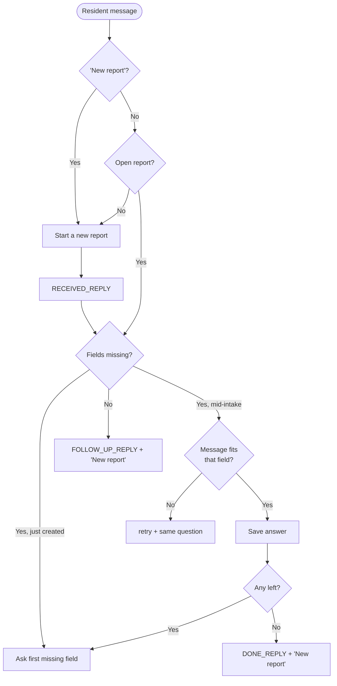
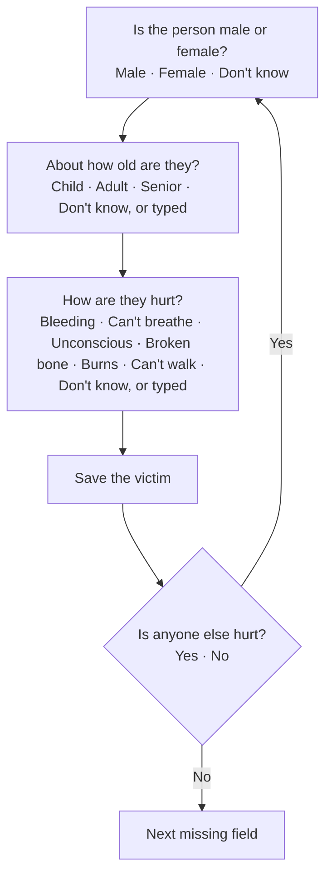

# Intake

Turns resident messages and form answers into reports.

- API: `apps/api/src/intake/`
- Web: `apps/web/src/features/intake/` (`/report` stub)
- Shared: `packages/shared/src/intake/`

## Creating a report

`IntakeService` is the only way to create a report: `receiveMessage` for chat messages and `createReport` for everything else.

### From a chat message

```ts
const { reportId, created } = await this.intake.receiveMessage({
  residentId,
  messageId,
  channel: 'messenger',
});
```

The first message creates a `pending` report straight away, so it reaches the feed even if the resident stops replying (US40). Later messages are linked to the same report while it's open: still `pending`, on the same channel, and the resident messaged about it in the last `OPEN_REPORT_MINUTES` (30). After that, the next message starts a new report. A per-resident lock makes a burst of messages open one report.

Pass `newReport: true` to start a report even when one is open. The old report stops taking messages, since only the report holding the resident's latest message is open.

`report:created` is emitted only when `created` is true.

`ChatIntakeService` registers this as a `ChannelsService.onMessage` handler, so every resident message goes through it.

## Questions

After the first message, the bot asks for the details the report still lacks, one at a time, in `INTAKE_FIELDS` order:



| Field           | Asked as                                | Answer                                                   |
| --------------- | --------------------------------------- | -------------------------------------------------------- |
| `incidentType`  | What happened?                          | Tap or type an active incident type's name or code       |
| `barangay`      | Which barangay is it in?                | Typed; matched by `BarangayService.findByName`           |
| `severity`      | How serious is it?                      | Tap or type a level (`parseSeverity`)                    |
| `anyoneHurt`    | Is anyone hurt?                         | Yes, No or Don't know (`parseAnyoneHurt`)                |
| `victims`       | Per person, see below                   | Tap or type each detail, or "Don't know"                 |
| `contactNumber` | What number can responders call you on? | PH mobile (`contactNumberSchema`); saved on the resident |

### People hurt

After a Yes, `victims` is missing until the report has a victim. Chat then asks about each person in turn, from `VICTIM_STEPS`:



Age is stored as a range (`parseAgeRange`). Answers can be typed in English, Tagalog or Hiligaynon, with numbers as digits or words ("eighteen", "disiotso", "labing-anim"); every form is listed in `AGE_RULES` (`packages/shared/src/intake/age.ts`).

| Answer                                   | `ageMin`   | `ageMax`   |
| ---------------------------------------- | ---------- | ---------- |
| "18", "about 18", "18 years old"         | 18         | 18         |
| "60-70", "60 to 70", "between 60 and 70" | 60         | 70         |
| "60s"                                    | 60         | 69         |
| "early 60s", "mid-60s", "late 60s"       | 60, 64, 67 | 63, 66, 69 |
| "60+", "60 and above", "at least 60"     | 60         | null       |
| "over 60", "more than 60", "lampas 60"   | 61         | null       |
| "under 18", "below 18", "wala pang 18"   | 0          | 17         |
| "18 and below", "up to 18", "18 pababa"  | 0          | 18         |
| "6 months", "2 weeks", "apat na buwan"   | 0          | 0          |
| Child (or "kid", "bata")                 | 0          | 17         |
| Adult (or "grown up", "tito", "tita")    | 18         | 59         |
| Senior (or "lolo", "lola", "matanda")    | 60         | null       |
| Don't know                               | null       | null       |

`formatAgeRange` shows it as "18 years old", "60-69 years old", "60+ years old" or "Under 18".

Each answer goes into a `VictimDraft` in the Chat SDK thread state (`IntakeState.victim`), and the person is saved as a victim after their condition. A draft holds its `reportId`, so one left from an older report is ignored. If the draft expires mid-person, the next message starts that person over. Answers about a person run under a per-report advisory lock (`IntakeService.withVictimLock`) that rereads the draft, so a quick second message ("Bleeding", then "from his head") stays on the report instead of saving the person twice.

Names are never asked for, and victims have no name field (FR9). A name typed anyway can only land in the condition.

Each field's question, retry text, choices and answer parsing live in `QUESTIONS` (`apps/api/src/intake/questions.ts`); add a field there and to `INTAKE_FIELDS`. Apart from the person being asked about, no question state is stored. Each follow-up message answers the first field still missing (`IntakeService.missingFields`), so a field filled any other way is never asked. Missing fields are rechecked after each answer, since one answer can add a question. An answer that doesn't fit gets the question again. After the last answer the bot thanks the resident once, with a "New report" quick reply. Later messages stay on the report as updates (the victim's condition, say), and each gets `FOLLOW_UP_REPLY` with the same quick reply, so no message goes unanswered.

### Another report

Sending "New report" (`NEW_REPORT_CHOICE`, tapped or typed in any case) starts a new report through `receiveMessage({ newReport: true })`, even mid-intake. The bot then asks its questions from the start, skipping the contact number it already has. This lets one sender, such as a barangay official, report several incidents in a row.

Answers go through `IntakeService.answer`, which emits `report:updated`. The contact number is saved on the resident, so their next report skips it.

### From known fields

```ts
const { id, trackingToken } = await this.intake.createReport({
  residentId,
  sourceChannel: 'messenger',
  incidentTypeId,
  barangayId,
  messageIds: [messageId],
  parsedAutomatically: true,
  parseConfidence: confidenceOf(parsed),
});
```

It validates the input against `reportInputSchema`, then in one transaction:

1. inserts a `pending` report and its victims
2. links `messageIds` to the report; throws if any isn't the resident's

It then emits `report:created` to the dashboard and returns the ID and tracking token for the confirmation message.

Leave unknown fields out; triage fills them in. Resolve names to IDs before calling: barangays through `BarangayService.findByName`, incident types by `code`.

## Parsing

Intake gets the parser through the `REPORT_PARSER` token:

```ts
constructor(@Inject(REPORT_PARSER) private readonly parser: ReportParser) {}

const parsed = await this.parser.parse(text);
if (!parsed) {
  // failed, timed out or unavailable: start the guided form
}
```

`parse` resolves to a `ParsedReport`, or null when parsing fails, times out or is unavailable. Until the classifier (#27) replaces it, `UnavailableParser` always returns null, so every message goes to the guided form.

## Contracts

| Schema                                                 | Shape                                                                         |
| ------------------------------------------------------ | ----------------------------------------------------------------------------- |
| `parsedReportSchema`                                   | Classifier output: each field as `{ value, confidence }`, 0–1                 |
| `parseConfidenceSchema`                                | `report.parse_confidence`: field → confidence                                 |
| `reportInputSchema`                                    | `createReport` input                                                          |
| `reportFeedItemSchema`                                 | A report as the triage feed shows it                                          |
| `reportDetailSchema`                                   | One report as a responder reviews it, with the contact number; see triage.md  |
| `reportCreatedEventSchema`, `reportUpdatedEventSchema` | Feed item payloads of `report:created` and `report:updated` (`REPORT_EVENTS`) |

Victims have no name field (FR9). In a `ParsedReport`, `victims.value` is null when the message doesn't say and `[]` when it says no one is hurt; pass `anyoneHurt: 'no'` for `[]`. `createReport` sets `anyoneHurt` to `yes` when given victims.

Emit feed items encoded (`reportFeedItemSchema.encode(item)`) so dates go out as ISO strings, and decode them on the client. `findFeedItems(db, where?)` and `findFeedItem(db, id)` in `triage/feed.ts` load them; see [triage.md](triage.md).

## Sample data

```sh
pnpm --filter api db:seed
```

Adds eight sample reports across statuses, incident types and barangays, each with a resident and its raw message. Skips if it already ran and refuses when `NODE_ENV` is `production`. Seeded residents have `web` identities named `seed-<n>`.
