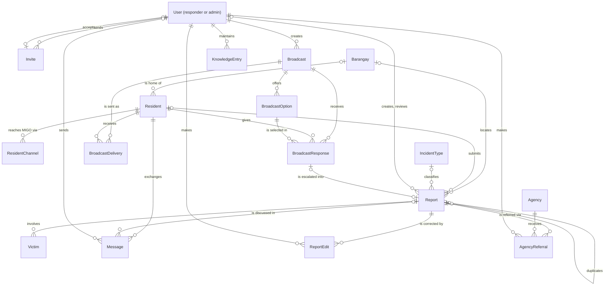
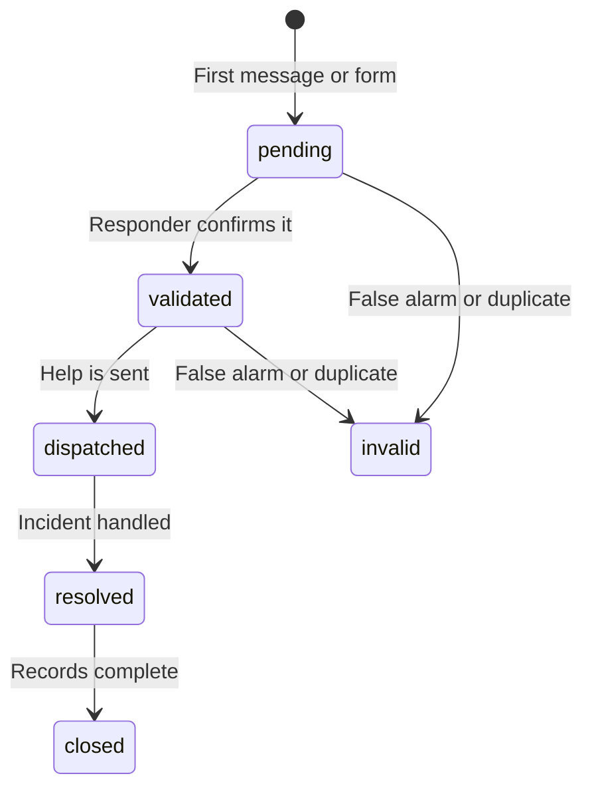
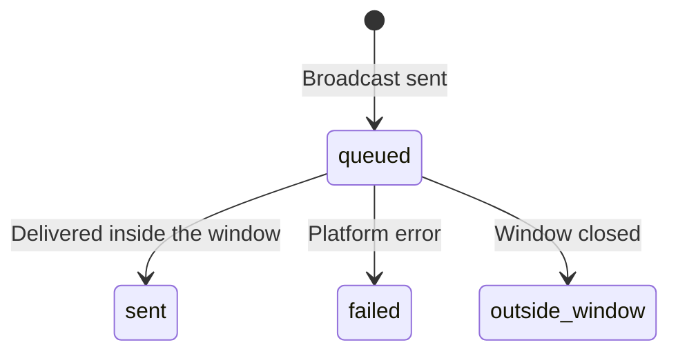
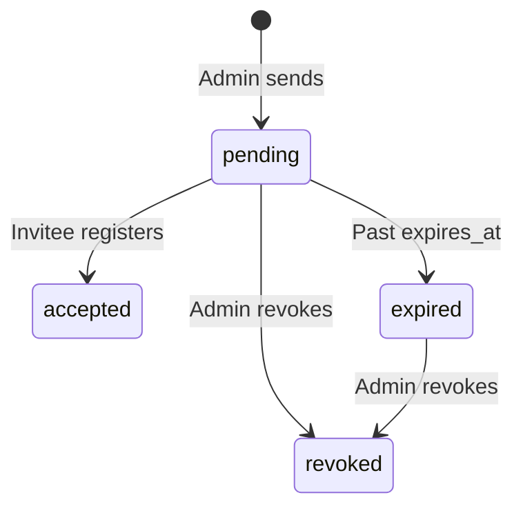

# Data model

What MIGO stores, how the entities relate, and the rules the schema keeps. Columns live in the Drizzle schema (`apps/api/src/database/schema/`), documented with JSDoc; conventions and tooling are in [database.md](../database.md).

## Entities

| Entity            | Is                                                                  |
| ----------------- | ------------------------------------------------------------------- |
| User              | A dashboard account (Better Auth), with role `admin` or `responder` |
| Invite            | An emailed invitation to create an account                          |
| Barangay          | One of Miagao's 119 barangays, with its boundary and hazard flags   |
| Resident          | A person who has messaged MIGO, with an optional profile            |
| ResidentChannel   | A resident's identity on one platform (Messenger PSID, web session) |
| Report            | An incident report                                                  |
| IncidentType      | A kind of incident a report can have                                |
| Victim            | A person hurt in a report, without a name                           |
| Message           | One inbound or outbound chat message                                |
| ReportEdit        | One correction or status change to a report                         |
| Broadcast         | An advisory or survey sent to many residents                        |
| BroadcastOption   | An answer a survey offers                                           |
| BroadcastDelivery | One send of a broadcast to one resident on one channel              |
| BroadcastResponse | A resident's survey answer                                          |
| Agency            | A partner agency for referrals and hotlines                         |
| AgencyReferral    | A report handed to an agency                                        |
| KnowledgeEntry    | MDRRMO's maintained content for chatbot answers                     |

The schema includes the Stretch entities (surveys, referrals, invites, knowledge base, duplicates, responder-created reports) so later features need few migrations.

## Lifecycles

### Report

Every change is a `ReportEdit` row. A report is never deleted; `invalid` retires it.

### Broadcast delivery

### Invite

An email can have one pending invite at a time, and an expired invite still counts until it is revoked.

## Rules

| Rule                                                                                                                                                                                                                                                                    | Why                                                                                                                                                                             |
| ----------------------------------------------------------------------------------------------------------------------------------------------------------------------------------------------------------------------------------------------------------------------- | ------------------------------------------------------------------------------------------------------------------------------------------------------------------------------- |
| **Records are permanent.** No `DELETE`; foreign keys restrict. Rows retire through status, `is_active` or `revoked_at`, and every report correction is a `ReportEdit` row. Reference data nothing references, such as a mistaken or test incident type, may be deleted. | Reports are official records kept for at least a year (NFR4), and corrections must be auditable (FR25). An unreferenced row is part of no record, so deleting it loses nothing. |
| **Victims have no name.** Only sex, age and medical condition.                                                                                                                                                                                                          | Privacy (FR9, NFR3).                                                                                                                                                            |
| **Victim age is a range** (`age_min`, `age_max`). An exact age has both equal; "60+" has no maximum.                                                                                                                                                                    | Reporters guess ("in his 60s", "a senior").                                                                                                                                     |
| **A report's resident is its sender.** `is_proxy` marks a report about someone else. A responder-created report from an unknown caller has no resident.                                                                                                                 | Proxies and witnesses report for others (FR8), and phone or radio reports have no chat sender (FR38).                                                                           |
| **Report fields stay null until known.** A report exists from the first message; `anyone_hurt` is null until asked, and `yes` with no victims means no details yet.                                                                                                     | No report is lost when a resident stops answering (FR40).                                                                                                                       |
| **Messages are the fallback record.** Saved before processing, unique per `(channel, external_id)`.                                                                                                                                                                     | A failed parse still leaves the raw text for a responder, and platform retries don't duplicate it.                                                                              |
| **Residents are reached per channel.** One `ResidentChannel` per platform identity, with the time of the resident's last message.                                                                                                                                       | One person can use Messenger and web chat, and Meta's messaging window is checked per identity.                                                                                 |
| **Broadcast targets aren't foreign keys.** `target_barangay_ids` is an array (empty means the whole municipality), plus an optional hazard matched against `Barangay.hazards`.                                                                                          | A target is a filter at send time; the deliveries record who was actually reached.                                                                                              |
| **Delivery counts come from deliveries.** One row per broadcast, resident and channel.                                                                                                                                                                                  | Only residents who have messaged the Page can be reached, so the target's size overstates reach.                                                                                |
| **Tracking tokens are random 128-bit strings.**                                                                                                                                                                                                                         | They're the only key to the public status page, so they must not be guessable.                                                                                                  |
| **Reference data is managed in the dashboard.** Incident types, agencies, barangay flags and knowledge entries are seeded by migration and edited by admins.                                                                                                            | They change without a code change (FR45–FR47).                                                                                                                                  |
| **Responders are Better Auth users.** No separate responder table; responder foreign keys are `text`.                                                                                                                                                                   | One account table for auth and roles.                                                                                                                                           |
| **Locations are PostGIS geometry in SRID 4326.** Points for reports and residents, multipolygons for barangays, with a centroid fallback.                                                                                                                               | Pins, containment checks and map queries.                                                                                                                                       |
| **Enums are defined once** in `@repo/shared` and only gain values.                                                                                                                                                                                                      | Validation and the database agree, and older releases keep working.                                                                                                             |
