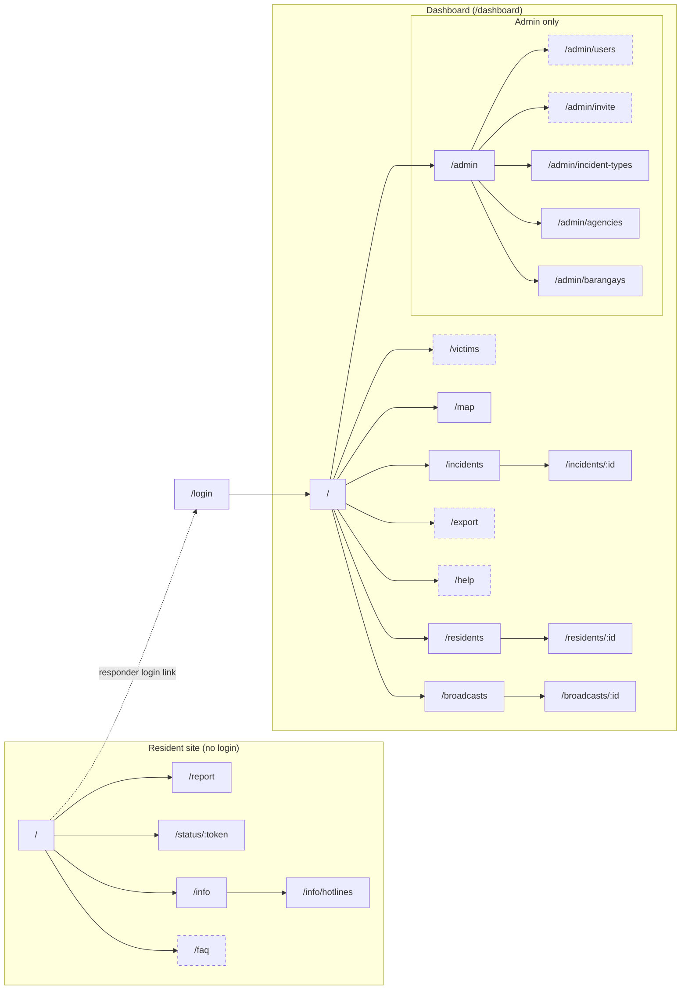

# Sitemap

Every route, its purpose and who can open it. Wireframes are in [Figma](https://www.figma.com/design/hW0DADlcpwQ231WD1uCaZX/CMSC128_Final-Project?node-id=4007-38091).

Dashed routes are Stretch or roadmap.

## Resident site (unauthenticated)

| Route            | Purpose                                                        |
| ---------------- | -------------------------------------------------------------- |
| `/`              | Homepage/entry point, links sites below                        |
| `/report`        | Report an incident through a public form (web chat is Stretch) |
| `/status/:token` | Public status tracking for a submitted report                  |
| `/info`          | Office info: contact, location, staff                          |
| `/info/hotlines` | Emergency hotline numbers by agency                            |
| `/faq`           | Knowledge-base grounded Q&A (Stretch)                          |

## Responder dashboard (authenticated)

Every route but `/login` sits under `/dashboard`.

| Route                   | Purpose                                                                                                | Access           |
| ----------------------- | ------------------------------------------------------------------------------------------------------ | ---------------- |
| `/login`                | Responder authentication                                                                               | -                |
| `/`                     | Home (summary charts and trends are Stretch)                                                           | all roles        |
| `/incidents`            | Live incident feed, filter/sort. Can open incident in a sheet detail without routing to /incidents/:id | all roles        |
| `/incidents/:id`        | Review, correct, referral log, messaging panel                                                         | responder, admin |
| `/residents`            | Resident directory                                                                                     | responder, admin |
| `/residents/:id`        | Resident profile, report and response history, edit details                                            | responder, admin |
| `/victims`              | Cross-incident victim roster (sex, age, condition), linked to source incidents (Roadmap)               | responder, admin |
| `/map`                  | Pin map of incidents (heatmap is Stretch)                                                              | all roles        |
| `/broadcasts`           | Compose an advisory and list past advisories and surveys (surveys are Stretch)                         | responder, admin |
| `/broadcasts/:id`       | Advisory delivery counts (survey results and escalation are Stretch)                                   | responder, admin |
| `/export`               | Spreadsheet sync, situational reports, DROMIC exports (Stretch)                                        | responder, admin |
| `/admin`                | Admin landing, links to user management and invites (Stretch)                                          | admin only       |
| `/admin/users`          | Manage responder accounts and roles (Stretch)                                                          | admin only       |
| `/admin/invite`         | Invite new responders (Stretch)                                                                        | admin only       |
| `/admin/incident-types` | Add, rename and retire incident types                                                                  | admin only       |
| `/admin/agencies`       | Partner agencies and their hotline numbers                                                             | admin only       |
| `/admin/barangays`      | Barangay coastal and upland flags and hazards, used for advisory targeting                             | admin only       |
| `/help`                 | In-app help and documentation (Stretch)                                                                | all roles        |
