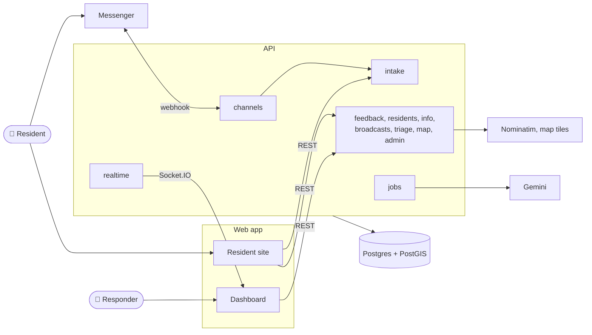
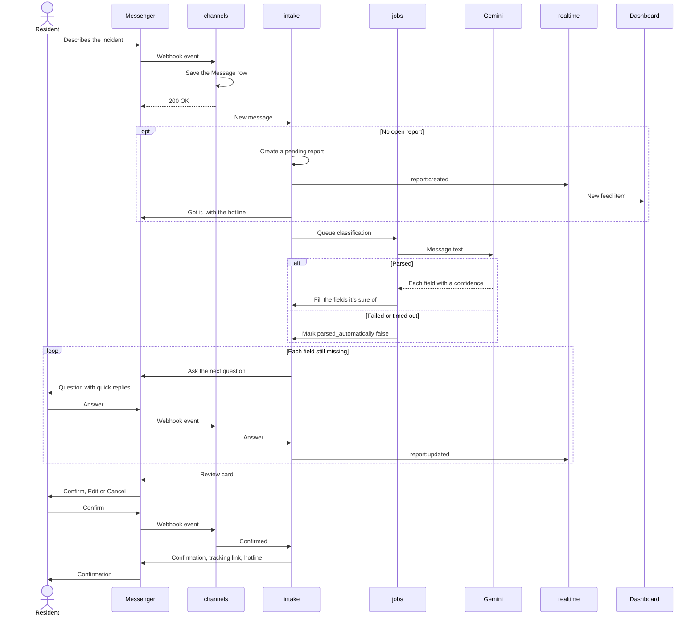
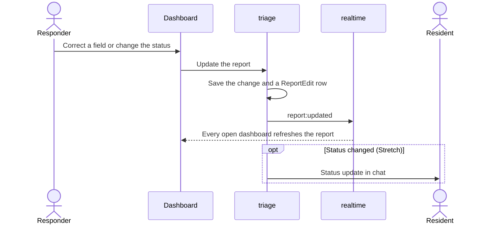
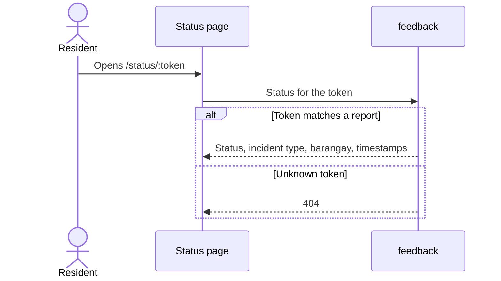
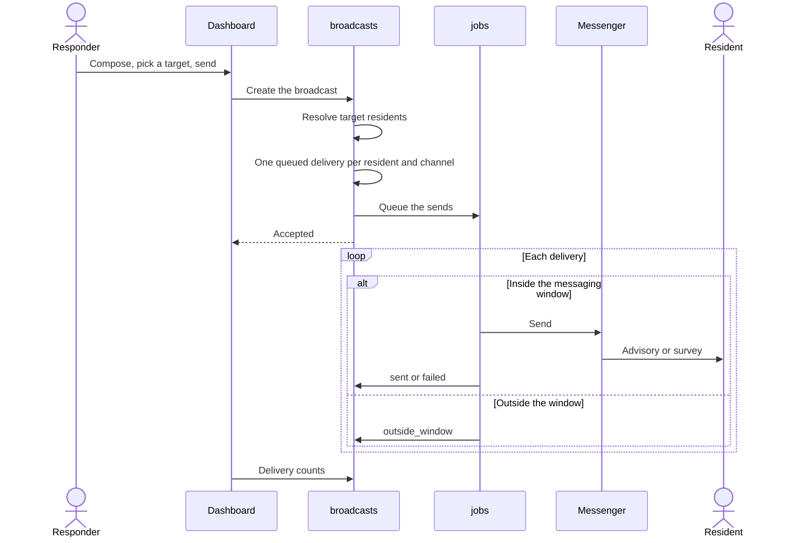
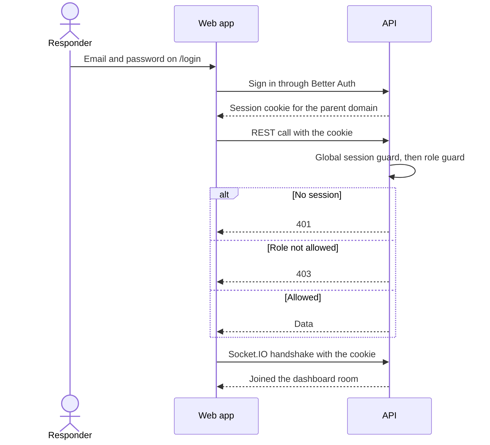
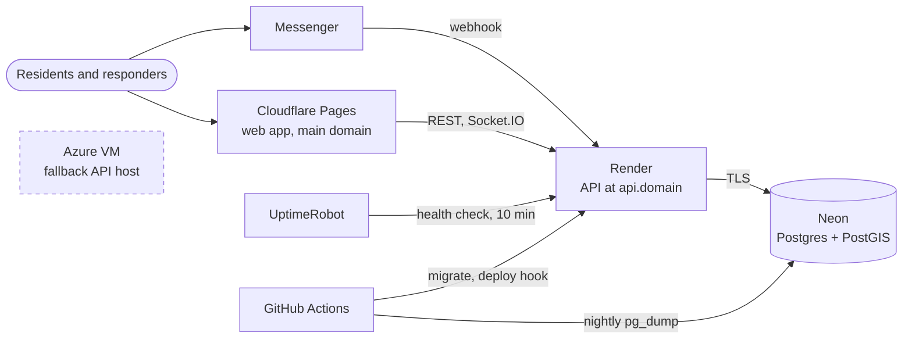
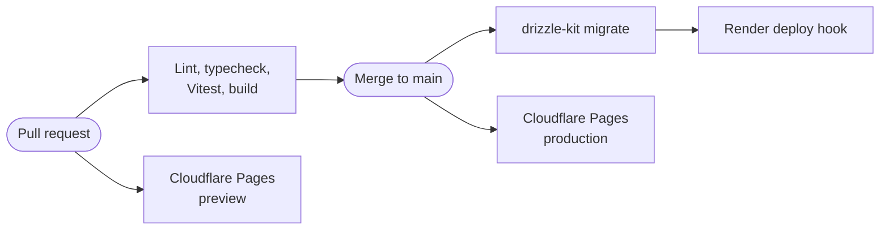

# Technical requirements

How MIGO is built to meet the [PRD](prd.md): architecture, integrations, the main interactions, security, the NFR approach, the stack and deployment. The data model is in [data-model.md](data-model.md); module paths and API layers are in [architecture.md](../architecture.md).

## Architecture

A modular monolith in three tiers, which can split into services later:

| Tier         | Runs                                           |
| ------------ | ---------------------------------------------- |
| Presentation | The web app: resident site and dashboard (PWA) |
| Application  | The API: one NestJS module per domain          |
| Data         | PostgreSQL with PostGIS                        |

### Modules

One module per epic, named the same in the API, web app, shared package, docs and issue labels.

| Module       | Epic | Owns                                                                                        |
| ------------ | ---- | ------------------------------------------------------------------------------------------- |
| `channels`   | EP1  | Messenger and web chat adapters, normalizing messages into Chat SDK's Thread and Message    |
| `intake`     | EP1  | Classifier pipeline, guided questions, public report form, proxy reports, victims, location |
| `feedback`   | EP2  | Confirmations, status replies, `/status/:token`                                             |
| `residents`  | EP3  | Profiles, resident directory, channel identities, opt-in                                    |
| `info`       | EP4  | Knowledge base, hotlines, FAQ grounding                                                     |
| `broadcasts` | EP5  | Advisories, surveys, delivery tracking, escalation                                          |
| `triage`     | EP6  | Live feed, filter and sort, edits with audit trail, referrals                               |
| `map`        | EP7  | Summary charts, map and heatmap (read-only)                                                 |
| `messaging`  | EP8  | Direct responder–resident threads                                                           |
| `compliance` | EP9  | Sheet sync, SitRep generation, form exports                                                 |
| `admin`      | EP10 | Accounts, roles, invites, reference data, KB and help content                               |

Platform modules serve the others:

| Module     | Does                                                         |
| ---------- | ------------------------------------------------------------ |
| `auth`     | Better Auth, the global session guard and role guards        |
| `realtime` | Socket.IO gateway; server-to-client pushes only              |
| `geo`      | Barangay lookup, Nominatim geocoding (cached), map tiles     |
| `jobs`     | pg-boss queues: outbound sends, classifier calls, sheet sync |

## Integrations

| Integration               | Called by                | Purpose                                                                                    |
| ------------------------- | ------------------------ | ------------------------------------------------------------------------------------------ |
| Messenger Platform        | `channels`               | Receive resident messages by webhook and send replies                                      |
| Gemini API (Flash tier)   | `intake`, `info`         | Classify reports (incident type, severity, barangay, proxy), extract free text, KB answers |
| Nominatim (OpenStreetMap) | `geo`                    | Geocode location text                                                                      |
| OpenFreeMap / OSM tiles   | web (`map`)              | Map tiles for MapLibre                                                                     |
| Weather provider          | `info`                   | Current conditions and forecasts (Stretch)                                                 |
| Google Sheets API         | `compliance`             | Spreadsheet sync (Stretch)                                                                 |
| SMTP provider             | `admin`                  | Invite emails (Stretch)                                                                    |
| Web Push                  | `broadcasts`, `feedback` | Notify web chat residents (Stretch)                                                        |

## Interactions

### Chat intake

- The message is saved before the webhook is acknowledged, and a unique `(channel, external_id)` on Message drops platform retries for good. Chat SDK's own dedup only covers a short window.
- The first message opens a pending report, so it reaches the feed even if the resident stops answering (FR40). Later messages fill in the same report.
- A field fills only when the classifier is confident about it; everything else is asked. The resident sees the same conversation either way, with fewer or more questions. Thresholds and the timeout come from the labeled test set.
- The same call also returns the message's intent (incident, status question, profile change or unclear), which routes it as in [user-flows.md](user-flows.md#start-a-conversation). A message that can't be classified is treated as an incident.
- A failed or timed-out parse leaves the report pending, linked to its raw message and marked for review. Nothing is lost.
- Location resolves in order: a barangay match, then a shared location (Messenger pin or browser geolocation), then cached Nominatim.
- The bot asks whether the report is about the sender. A no sets `is_proxy` (Stretch). Victims are recorded without names (FR9).
- The public `/report` form skips the chat adapter and calls the same intake service, so both channels feed one pipeline (NFR6).
- Web chat (Stretch) is a React UI behind a custom Chat SDK adapter, so it takes the Messenger path above unchanged.

### Live feed and corrections

Clients change data only through REST. Socket.IO carries server pushes, with a target of under 5 s (NFR8).

### Status page

The token is random and 128-bit, so it can't be guessed, and the page never shows personal details.

### Broadcasts

- A Page can message a resident freely only inside Meta's standard window after the resident's last message, tracked by `ResidentChannel.last_inbound_at`. Outside it, only limited message types are allowed.
- Only residents who have messaged the Page can be reached, so the dashboard shows real delivery counts, not the size of the target.
- Targets are the whole municipality by default, or barangays and hazards matched against `Barangay.hazards`.
- Messaging needs a Facebook Page (the team's MIGO Page) and Meta App Review for messaging permissions.

### Sign-in and roles

- The web app and `api.<domain>` share the session through Better Auth's cross-subdomain cookies. CORS allows credentials from the web origin only.
- Every route needs a session unless marked public. Roles are `admin` and `responder`; an admin can do everything a responder can.

## Security and privacy

- Victim names and ID photos are never stored. ID OCR (Stretch) uses an extracted name only in memory, for verification.
- The status page shows only status, incident type, barangay and timestamps.
- HTTPS comes from Cloudflare Pages and Render. Postgres requires TLS, and its credentials live only in the API's environment.
- Secrets live in GitHub Actions secrets and Render environment variables, never in the repo.
- Every correction is logged in `ReportEdit`, and rows retire through status. Nothing is hard-deleted.
- Report text goes to Gemini, so its data terms must satisfy NFR3 before go-live.
- If object storage is added (Stretch), buckets stay private and files are served through signed URLs.

## Non-functional requirements approach

| NFR               | Approach                                                                                                                                                        |
| ----------------- | --------------------------------------------------------------------------------------------------------------------------------------------------------------- |
| NFR1 Uptime       | Render restarts the API on failure. UptimeRobot pings `/health` every 10 minutes, which also keeps the free instance awake. An Azure VM is the fallback host.   |
| NFR2 Security     | Session guard on every route, role guards, TLS everywhere. See [Security and privacy](#security-and-privacy).                                                   |
| NFR3 Privacy      | No victim names, a privacy notice with its time recorded (FR41), minimal fields on public pages.                                                                |
| NFR4 Retention    | No automatic deletion. Nightly `pg_dump` kept as a workflow artifact (90 days at most). Free tiers can't hold 1-year backups; revisit if hosting gets a budget. |
| NFR5 Brownouts    | The dashboard caches the app shell and the last-loaded feed for read-only offline use, with a "last updated" banner. Every bot message carries the hotline.     |
| NFR6 Redundancy   | Messenger and the public web form feed the same intake service. Either works if the other fails.                                                                |
| NFR7 Coexistence  | Sheet sync and form exports (Stretch) feed the office's existing records instead of replacing them.                                                             |
| NFR8 Realtime     | Socket.IO pushes, under 5 s from report to feed.                                                                                                                |
| NFR9 Old hardware | The map loads lazily. Tested on the office's oldest PC.                                                                                                         |
| NFR10 Load spikes | Webhooks acknowledge at once, and classifier calls and sends queue in pg-boss.                                                                                  |
| NFR11 Maintenance | One language (TypeScript) end to end, one module per domain, docs in the repo.                                                                                  |
| NFR13 Cloud       | Managed free tiers: Cloudflare Pages, Render, Neon.                                                                                                             |

## Tech stack

### Repo

| Concern  | Choice                                                                                   |
| -------- | ---------------------------------------------------------------------------------------- |
| Monorepo | pnpm workspaces + Turborepo: `apps/web`, `apps/api`, `packages/shared`. Node 22 or later |
| Config   | `@repo/typescript-config`, `@repo/eslint-config`                                         |
| Shared   | `@repo/shared`: Zod 4 only, ESM, built with `tsc -b`                                     |
| Testing  | Vitest in every package (the API through unplugin-swc)                                   |

`@repo/shared` holds Zod enums (the single source for Drizzle `pgEnum` and validation), codecs, constants, and one folder per module with request and response schemas, Socket.IO payloads and small pure helpers. The Drizzle schema, Better Auth config, classifier prompts and React components stay in their app.

### Frontend

| Concern       | Choice                       |
| ------------- | ---------------------------- |
| Framework     | React + Vite                 |
| Routing       | TanStack Router (file-based) |
| Data fetching | TanStack Query               |
| Forms         | TanStack Form + Zod          |
| Tables        | TanStack Table               |
| UI            | Tailwind CSS + shadcn        |
| Charts        | Recharts                     |
| Maps          | MapLibre GL JS               |
| Realtime      | socket.io-client             |
| Auth          | Better Auth React client     |
| PWA           | vite-plugin-pwa              |

### Backend

| Concern         | Choice                                                                         |
| --------------- | ------------------------------------------------------------------------------ |
| Framework       | NestJS 11, modular monolith                                                    |
| ORM             | Drizzle 0.45.x, a global NestJS provider                                       |
| Validation      | nestjs-zod with schemas from `@repo/shared`                                    |
| Auth            | Better Auth (admin plugin, Drizzle adapter) via `@thallesp/nestjs-better-auth` |
| Background jobs | pg-boss                                                                        |
| Realtime        | Socket.IO through a NestJS gateway                                             |
| Chat            | Vercel Chat SDK with the Messenger adapter and `@chat-adapter/state-pg`        |
| LLM             | Gemini Flash through the Vercel AI SDK (`generateObject` with a Zod schema)    |
| PDF             | pdfmake (Stretch)                                                              |
| Spreadsheets    | googleapis for Google Sheets, exceljs for .xlsx (Stretch)                      |
| Email           | Nodemailer over SMTP (Stretch)                                                 |
| Push            | Web Push (Stretch)                                                             |

### Data

- Drizzle owns every table, including Better Auth's, so drizzle-kit is the only migration tool. Better Auth's tables are generated into the Drizzle schema by its CLI.
- PostGIS columns are `geometry` in SRID 4326 through a `customType`, since Drizzle's built-in type drops the SRID. Distances in meters cast to `geography`, and spatial queries use the `sql` template.
- Chat SDK keeps dedup, locks and subscriptions in `chat_state_*` tables on the same database. They're outside the Drizzle schema, hold no records and are safe to wipe. Thread history and LLM context come from the Message table, never from SDK state.
- A `ReportParser` interface in `intake` hides the classifier, so a failed or missing parser falls back to the guided questions.
- No file storage in committed scope: PDFs and spreadsheets are generated on request.

## Deployment

| Concern    | Approach                                                                                                                                                               |
| ---------- | ---------------------------------------------------------------------------------------------------------------------------------------------------------------------- |
| Local      | Docker Compose for Postgres/PostGIS, or a Neon branch where Docker can't run                                                                                           |
| Demo       | Free tiers: web on Cloudflare Pages, API on Render, database on Neon                                                                                                   |
| Free tiers | Render sleeps after about 15 idle minutes, hence the UptimeRobot ping (750 free hours cover one service). pg-boss polling keeps Neon awake, so watch its compute hours |
| Fallback   | An Azure for Students VM running the API in Docker, if Render's limits get in the way                                                                                  |
| Domain     | A free 1-year domain from the GitHub Student Developer Pack: the web app at the root, the API, Socket.IO and webhook at `api.<domain>`                                 |
| Rollback   | Redeploy the previous Render release. Migrations stay backward-compatible for one release                                                                              |
| Backups    | Nightly `pg_dump` from a scheduled workflow, stored as a workflow artifact, with a restore drill before code freeze                                                    |
