# User flows

What residents and responders do in MIGO, step by step. Routes are in [sitemap.md](sitemap.md).

Flows that pass between people are swimlane diagrams: one lane per actor, with MIGO (the bot and the API) as its own lane, so each handoff is visible. Flows with one actor are plain flowcharts. Rounded boxes start and end a flow, diamonds are decisions, and dashed boxes are Stretch.

## Use cases

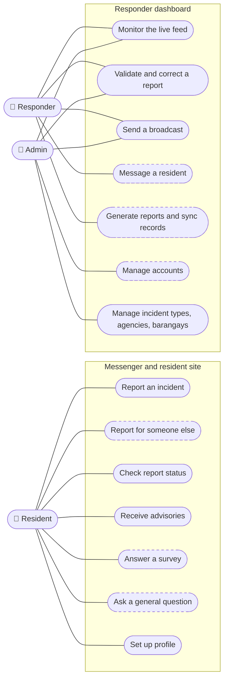

An admin can do everything a responder can. Barangay officials use the resident flows.

## Resident flows

### Start a conversation

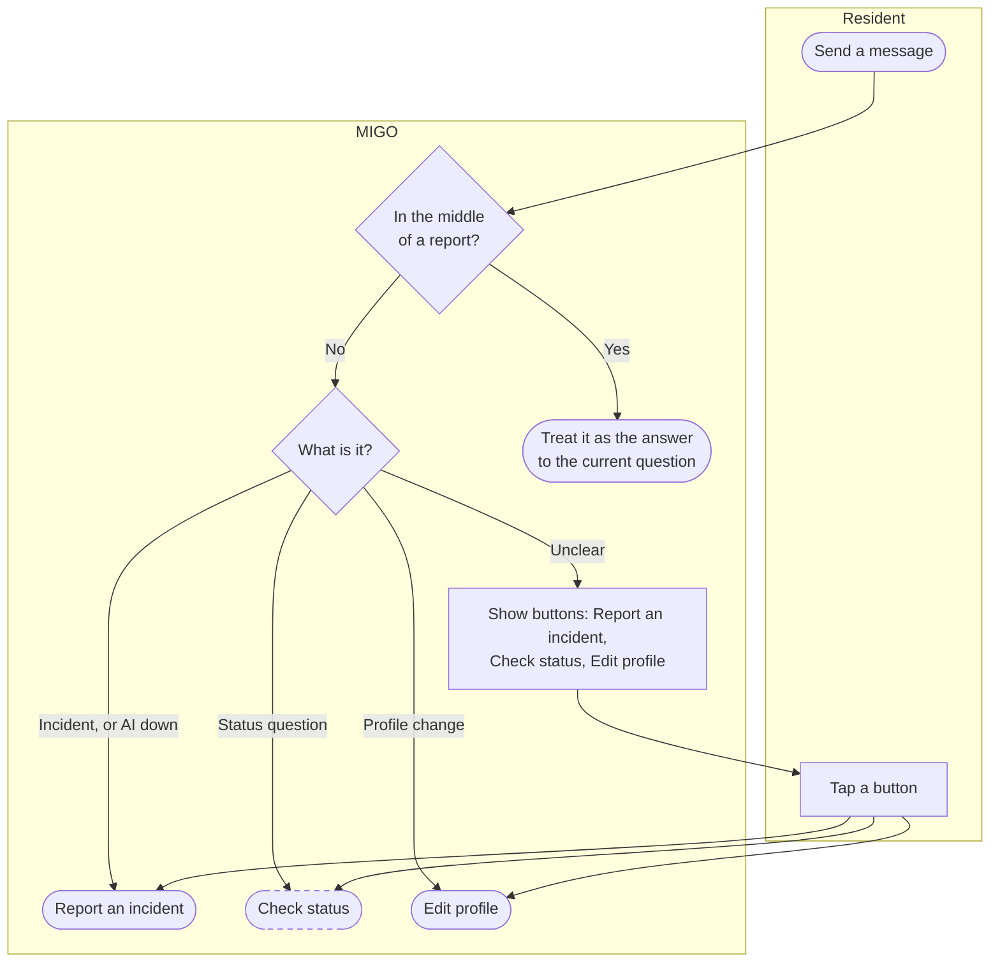

- The same three buttons are always in Messenger's persistent menu.
- A message the AI can't classify because it's down starts a report, so an emergency never waits on a tap. Responders mark the non-incidents invalid.
- Tapping Report an incident after an unclear message makes that message the report's first message, so the resident doesn't repeat it.
- The bot replies in the resident's language preference (Hiligaynon, Kinaray-a, Tagalog or English), Tagalog by default. Changing it through Edit profile is Stretch.
- "Stop" opts the resident out of broadcasts. The bot still answers reports, since MIGO is an emergency line.

### Report an incident

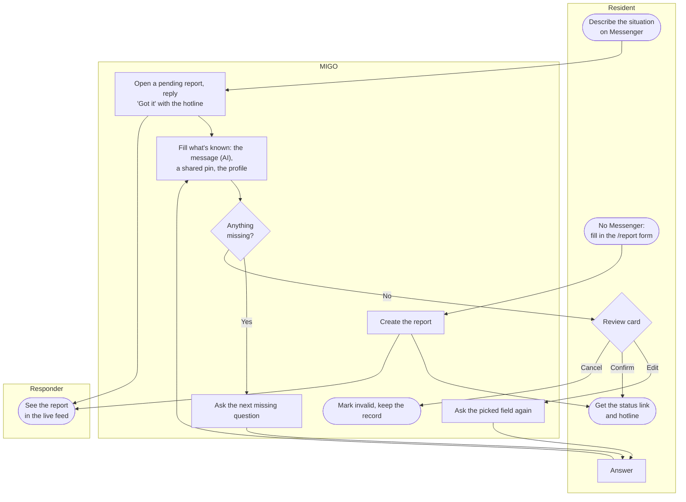

There is one way to report. The AI only decides how many questions get skipped: if it read everything, the resident goes straight to the review card; if it read part, the bot asks the rest; if it failed or is down, the bot asks every question. All three look like the same conversation.

#### Questions

Only the missing ones are asked, in this order:

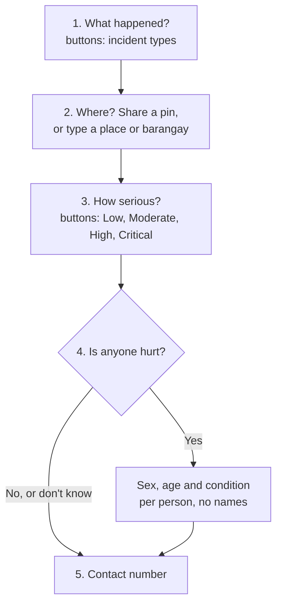

- There's no description question: the first message is the description.
- Every question has buttons, and residents can type instead. A typed answer is matched to an option ("nasusunog" → Fire); without a match, the buttons are shown again.
- A typed place the map can't find counts as no pin. The bot asks once for a pin, then accepts whatever the resident gives.
- The contact number is skipped when the profile has one.
- A message that doesn't answer the current question ("may naipit pa") is kept on the report as an extra detail and read for any fields it fills. Then the question is asked again.

#### Review card

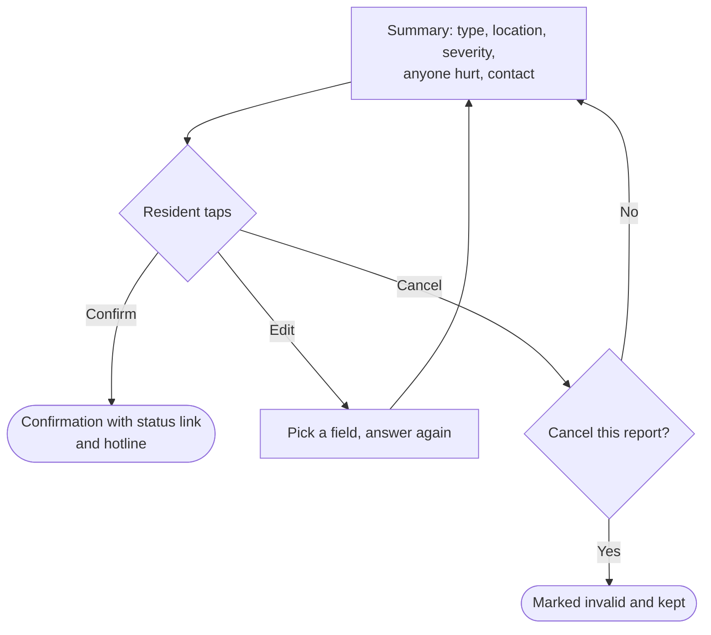

- A report that's never confirmed still stands in the feed.
- Residents can cancel only while the report is pending. Once a responder validates it, cancelling goes through the hotline.
- A cancelled report shows in the feed as cancelled by the resident.
- A message after cancelling starts a new report.

#### Rules

- **Nothing blocks reporting.** There's no sign-up first; a name and contact number given in a report are saved to the profile.
- **Never ask what's known.** A pin or detail sent at any point fills its field and removes that question.
- **The AI is optional.** Every place it classifies or extracts something falls back to buttons or a question, so a failure only means more taps.
- **An unsure AI asks.** It shows buttons instead of guessing, with Report an incident first.
- **The hotline comes first.** The first reply already carries it, so a life-threatening report doesn't wait on the questions.

### Report on behalf of someone else (Stretch)

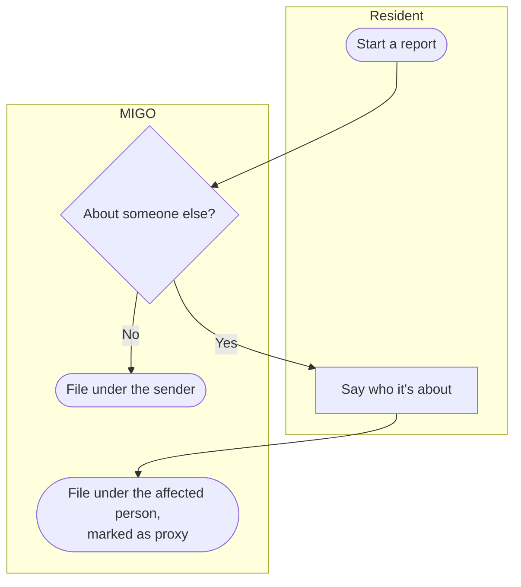

### Check status of a report

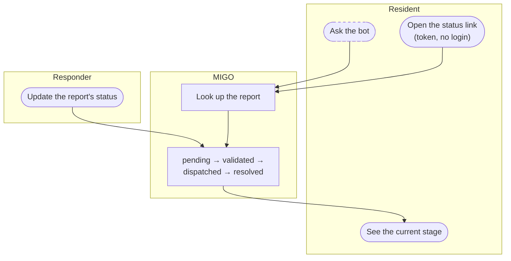

### Receive and respond to a broadcast

The resident's side of [Compose and send a broadcast](#compose-and-send-a-broadcast).

### Ask a general question (Stretch)

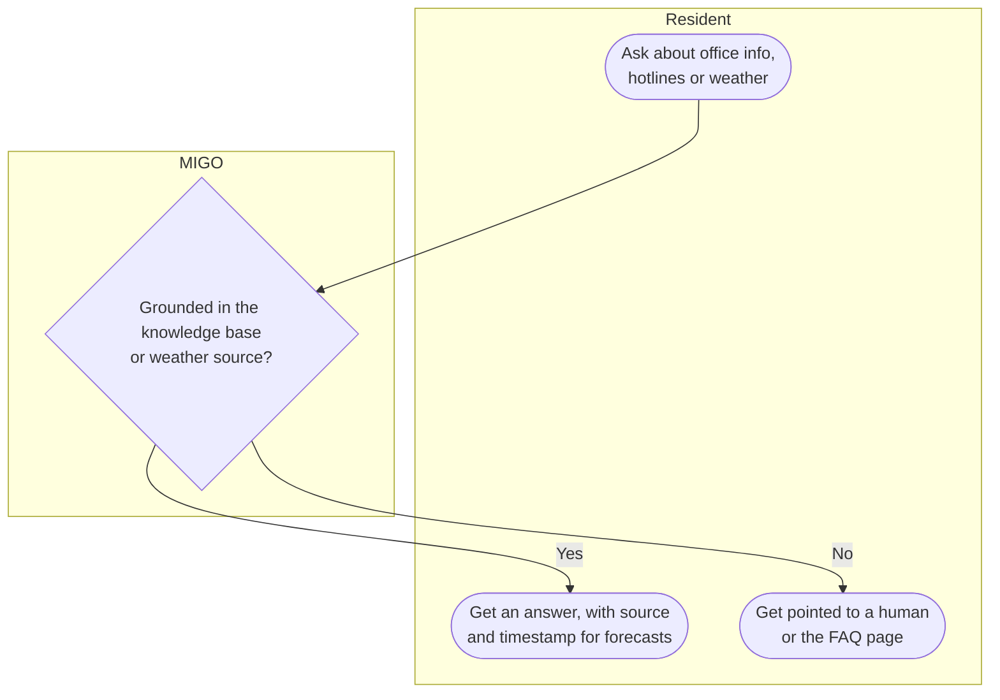

### Set up profile and preferences

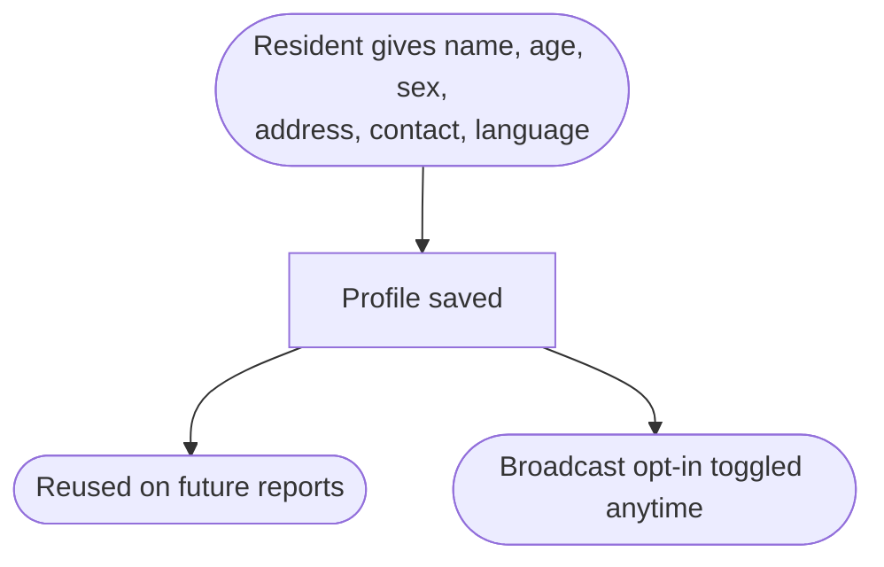

## Responder flows

### Monitor the live incident feed

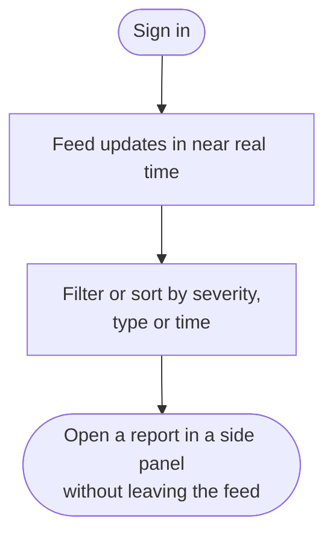

### Validate and correct a report

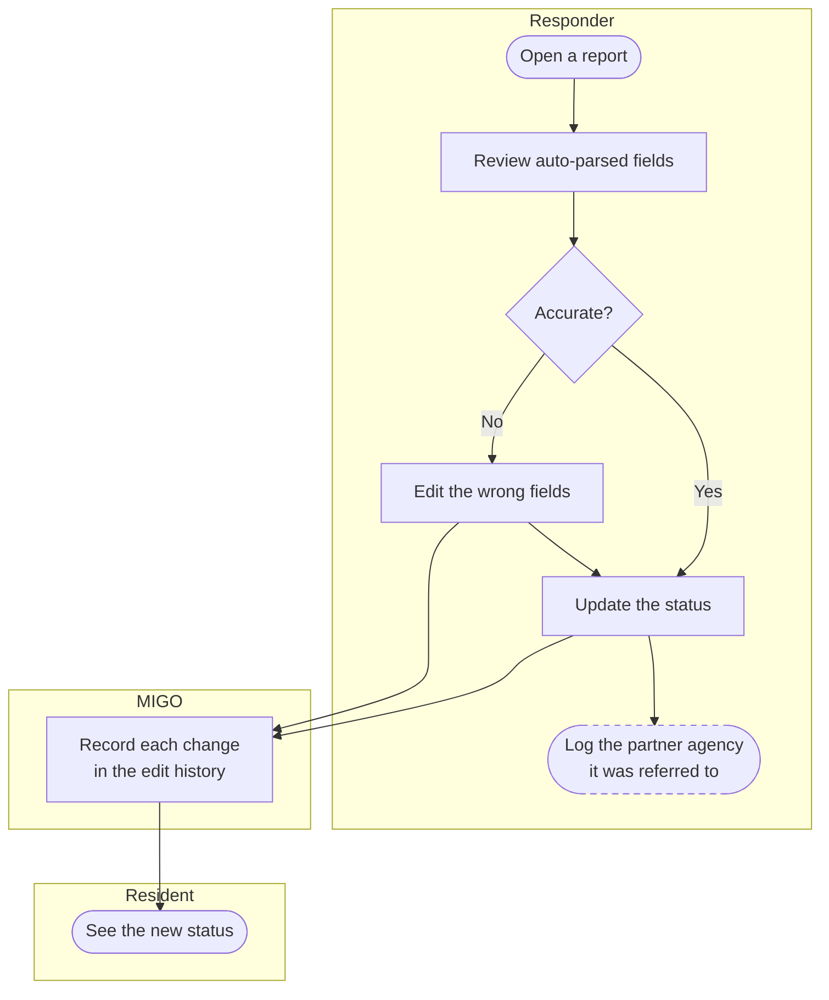

### Compose and send a broadcast

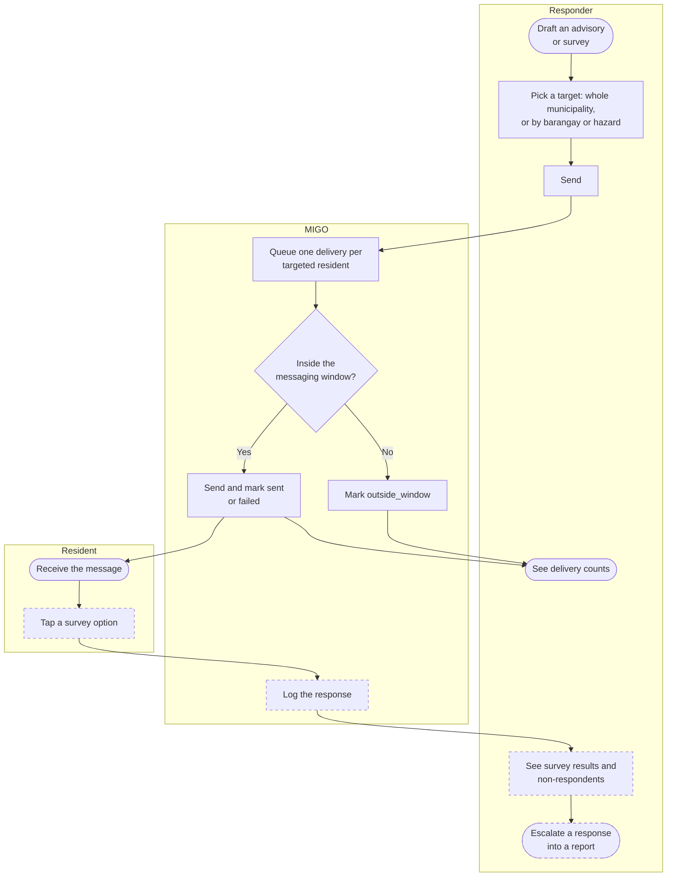

Only residents who have messaged the Page can be reached, so delivery counts show real reach, not the size of the target.

### Message a resident directly (Stretch)

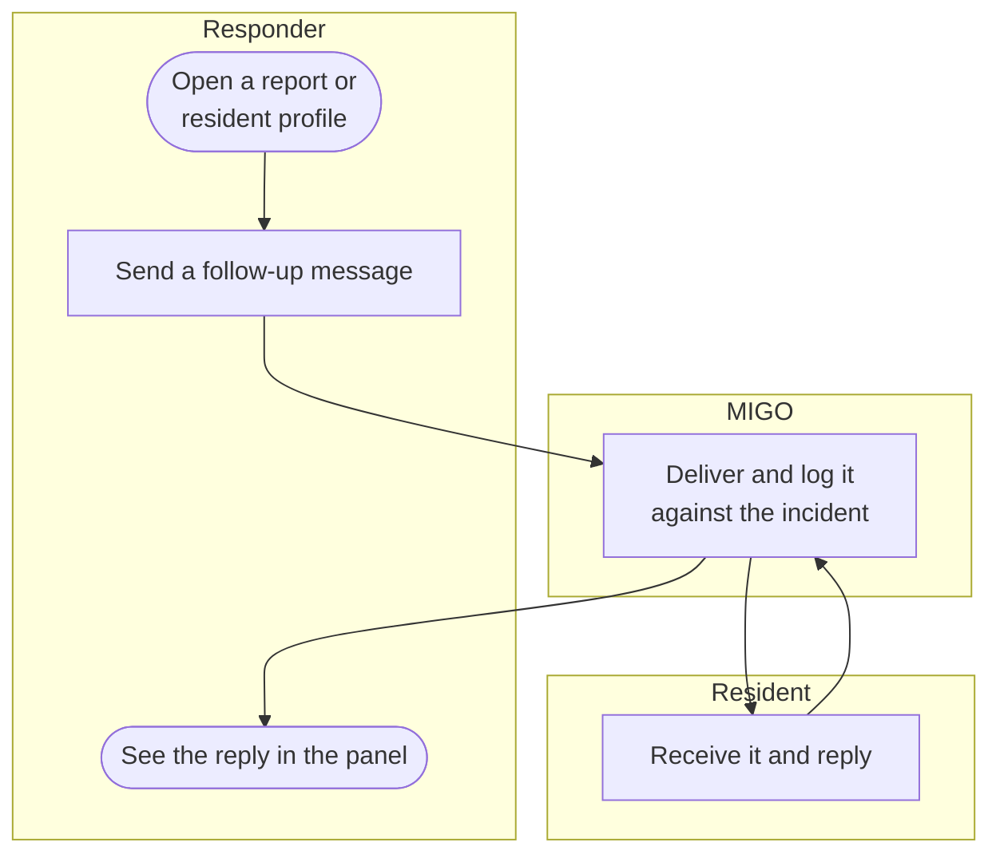

### Generate reports and sync records (Stretch)

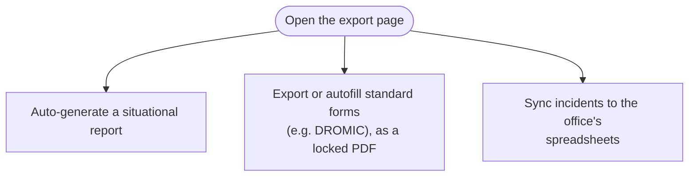

### Manage accounts (admin, Stretch)

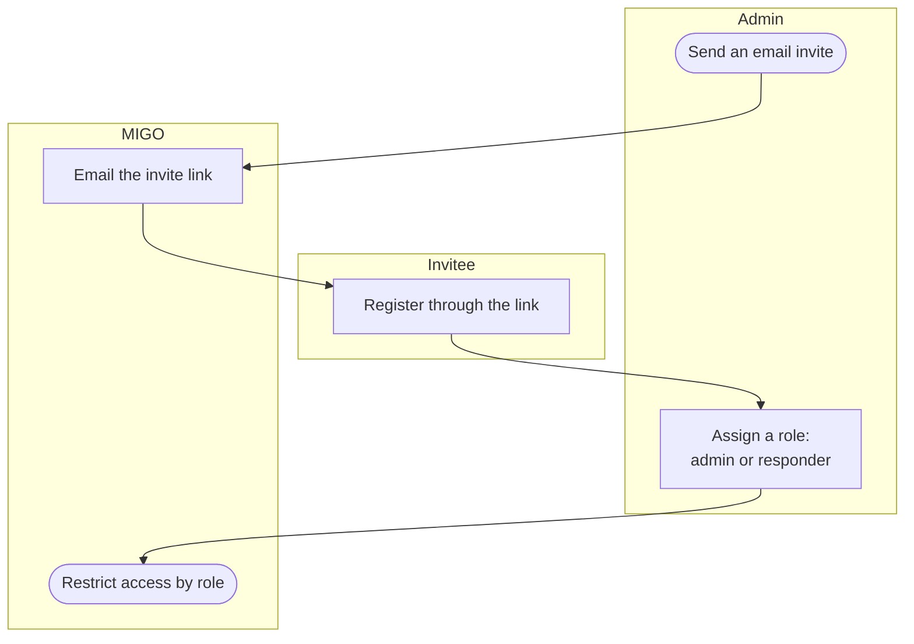
